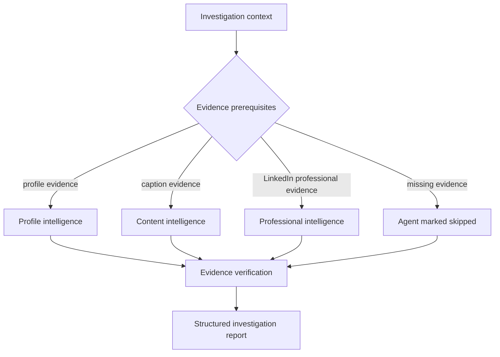

# Multi-Agent Architecture

## Current implementation

The current agent layer is a typed, evidence-first orchestration scaffold. The implemented agents perform deterministic extraction and structured observations; they do not call an LLM and are not presented as AI analysis. A model provider and credentials are not configured, so model-dependent tasks must remain unavailable until that integration is supplied.

## Agent contract

Each `InvestigationAgent` declares a stable name, a `canRun(context)` prerequisite check, and an asynchronous `run(context)` method. The typed context contains the normalized target and provenance-bearing evidence records. Outputs contain status, summary, evidence-linked observations, limitations, and an optional error.

The orchestrator runs eligible independent agents concurrently with `Promise.allSettled`. Ineligible agents are recorded as skipped. An agent error is isolated and recorded without discarding successful results. Evidence verification removes findings with missing evidence references and marks findings based on user-supplied material for review. The report aggregates only verified references and agent limitations.

## Implemented specialists

- **Profile intelligence:** reports the presence of profile text and states that it is an unverified claim.
- **Content intelligence:** extracts literal hashtags from supplied captions. It does not infer sentiment, toxicity, intent, or personal traits.
- **Professional intelligence:** records supplied experience, education, skill, or certification material as unverified claims.
- **Toxicity/language classification:** optionally sends up to five supplied captions to the configured Hugging Face classifier only when the investigation explicitly records external-provider consent. It preserves model labels/probabilities as model output and marks them for human review; it does not infer a trait or risk score about the person.
- **Evidence observation:** optionally uses the explicitly selected Gemini, Groq, or local Ollama provider after external-provider consent. It has a strict evidence/text limit, requires exact quotes from cited evidence, drops outputs without a matching source quote, and marks accepted observations for review.
- **Evidence verification:** checks evidence references and preserves review status for user-provided material.
- **Investigation orchestration:** routes by evidence availability, isolates failures, and assembles the report.

Gemini image analysis, LLM report generation, external URL reputation checks, and username cross-source search are not implemented. The text evidence agent is wired to the provider abstraction but has only been tested with mocked model responses; no provider has been live-tested. Hugging Face predictions are also only tested with mocked responses, not a live key.

## Evidence and confidence

Agents receive structured evidence with an ID, platform, type, content, origin, source label, and collection timestamp. Findings must cite at least one existing evidence ID. The current limited/moderate confidence field describes the narrow observation only; it does not indicate that an underlying profile claim is true. User-provided sources remain `requires_review`.

There is no overall trust, authenticity, or risk score. An empty evidence set produces skipped agents and an unavailable collection status, not a negative judgment about the profile.

## Error handling and tests

The orchestrator catches individual rejected agent promises and records a failed agent output. It does not currently implement persistence, job retries, cancellation, durable progress, or timeouts; these require the investigation storage and worker design.

Run the focused tests on Node 22 with `npm test`. Coverage includes conditional skipping, evidence traceability, unsupported-finding removal, and failure isolation.
